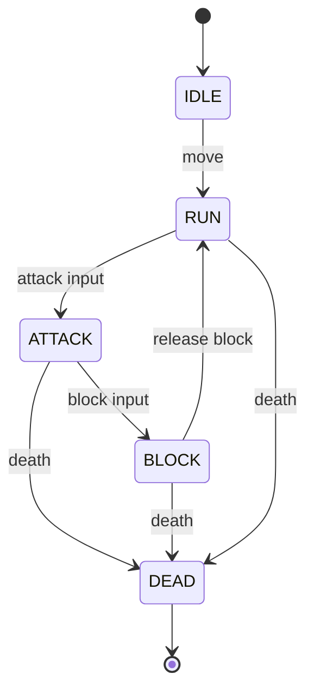

# Technical Architecture Document

## 1. Directory Structure Standards
```text
res://
├── assets/
│   ├── materials/           # Shared StandardMaterial3D or ShaderMaterials
│   ├── models/              # Exported .glb assets from Blender MCP
│   └── textures/             # Compact color swatches / CC0 textures
├── scenes/
│   ├── arena/               # Arena environment scenes, colliders, lighting
│   ├── combat/              # Hitbox3D, Hurtbox3D, DamageNumber UI components
│   ├── entities/            # Player.tscn, EnemyDummy.tscn
│   └── ui/                  # HUD, health bars, menus
└── scripts/
    ├── combat/              # Combat calculations, HitData class
    ├── entities/            # PlayerController.gd, EnemyController.gd
    ├── state_machine/       # StateMachine.gd, State.gd, entity states
    └── utils/               # Constants, Math helpers
```

---

## 2. Core Technical Patterns

### A. Combatant Architecture (Composition Pattern)
- Every combatant uses `CharacterBody3D` as physics root.
- Decouple **Visuals** from **Physics**:
  - `CollisionShape3D` maintains standard physics collision.
  - `Visuals` (`Node3D`) can rotate independently to face movement or attack direction.
- Combat components:
  - `Hitbox3D` (`Area3D`): Active collision trigger during attack frames.
  - `Hurtbox3D` (`Area3D`): Passive receiver listening for incoming `HitData`.
  - `HealthComponent` (`Node`): Handles health, damage mitigation, and death signals.

### B. Finite State Machine (FSM)
- Centralized `StateMachine` node with dedicated state child scripts (e.g. `IdleState.gd`, `MoveState.gd`, `AttackState.gd`, `HurtState.gd`).
- Clean separation of concern: each state only handles its own inputs and animation transitions.

### D. Combat Feedback Architecture
- `CombatFeedback` node coordinates the feedback pipeline, including hit reaction, camera recoil, VFX, damage numbers, attack telegraph, and audio hooks.



### C. Blender MCP Pipeline
- Live Blender driving via `mcp-for-blender`.
- Geometry authored with low triangle budget (< 3000 tris).
- Pivot/Origin enforced at ground contact.
- Export destination: `D:/Game 3D/Game_3D/assets/models/<name>.glb`.
  - Note: Some VFX such as `SlashArcVFX` and `AttackTelegraphVFX` are generated at runtime as procedural meshes.

---

## 3. Testing & Verification Infrastructure
- **Headless binary**: `D:\Game\godot_editor\Godot_v4.3-stable_win64_console.exe`
- **Pre-commit sanity check**:
  ```powershell
  & "D:\Game\godot_editor\Godot_v4.3-stable_win64_console.exe" --path "D:\Game 3D\Game_3D" --headless --check-only
  ```

---
- Integration/testing scene: `CombatTestArena.tscn` demonstrates the current combat prototype.

## 4. Architectural Items To Be Determined (TBD)
- **Input Map** is defined in `project.godot`. The following actions are implemented:
  - `move_forward`
  - `move_backward`
  - `move_left`
  - `move_right`
  - `jump`
  - `sprint`
  - `attack`
  - `block`
  - `ui_cancel`
- **Damage Formula & Armor [TBD]**: Flat reduction vs percentage mitigation.
- **Animation Framework [TBD]**: AnimationTree state machine vs code-driven procedural animations / tweening.
- **Audio System**: Audio hooks/signals exist in `CombatFeedback`. A full production audio system and assets are not implemented.
